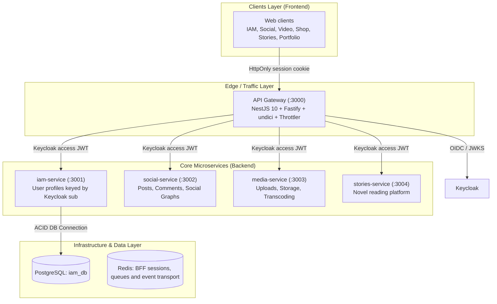

# Architecture

Mục lục architecture docs hiện hành của **Reals Platform**. Mã nguồn và cấu hình triển khai là nguồn xác nhận trạng thái thực tế; các tài liệu dưới đây mô tả ranh giới, quyết định và hướng dẫn duy trì.

---

## 1. Bản đồ hệ thống

---

## 2. Service documentation

Service snapshots are intentionally not duplicated here. Read the service's current source, package README, and `CLAUDE.md` for implementation details; keep stable cross-service decisions in the platform records below.

---

## 3. Các Nguyên tắc Kiến trúc Cốt lõi (Architectural Guiding Principles)

1. **Database-per-Service & Domain Isolation:**
   - Mỗi microservice sở hữu toàn quyền một cơ sở dữ liệu riêng biệt. Tuyệt đối không query cross-database hoặc import relative path giữa các microservice.
2. **Edge Gateway as Single Public Boundary:**
    - Web clients gọi `services/gateway` (`:3000`) bằng HttpOnly session cookie. Gateway giữ token server-side và chuyển Keycloak access JWT xuống service; response contracts được migrate tương thích ngược theo từng consumer.
3. **Zoneless & Signals-First Frontend:**
   - Ứng dụng Web loại bỏ `zone.js` (`provideZonelessChangeDetection`), quản lý trạng thái phản ứng trực tiếp qua Angular Signals để đạt hiệu năng tối đa và giảm bundle size.
4. **Shared Platform Packages via Published SDKs:**
   - Mã nguồn dùng chung (Logging, Tracing, Security, Http Common, Config, Event Contracts) được đóng gói độc lập trong repository `platform/` và phát hành dưới dạng package `@daccuong-uit/*`.
5. **Event-Driven Eventual Consistency:**
    - Event bền vững dùng Outbox/Streams trong `@daccuong-uit/backend-event-bus`; các consumer Pub/Sub cũ được migrate theo [implementation sync plan](./implementation-sync-cleanup-plan.md).

## 4. Platform design records

- [Platform backend](./platform-backend-plan.md)
- [Platform frontend](./platform-frontend-plan.md)
- [Shared contracts](./shared-contracts-plan.md)
- [SSO target architecture](./auth-sso-target-plan.md)
- [Implementation sync and cleanup](./implementation-sync-cleanup-plan.md)
